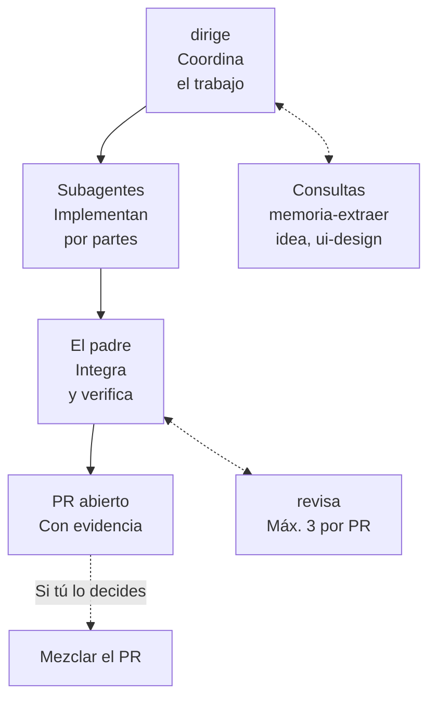
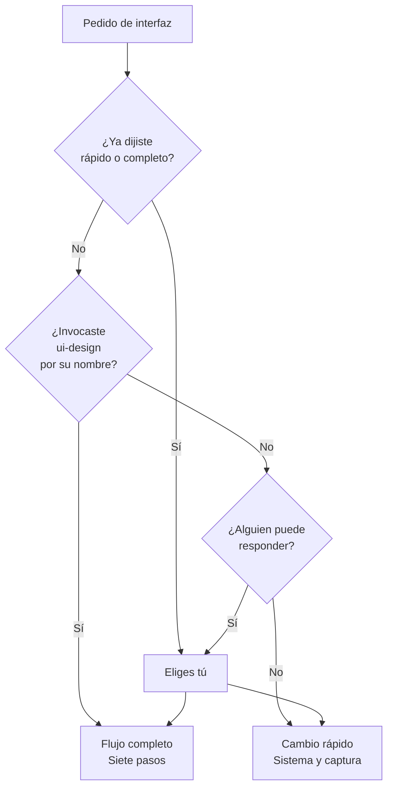
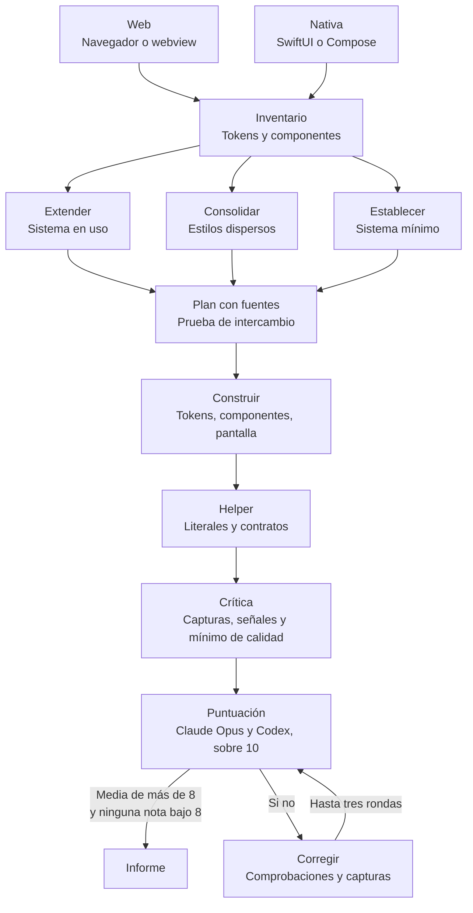
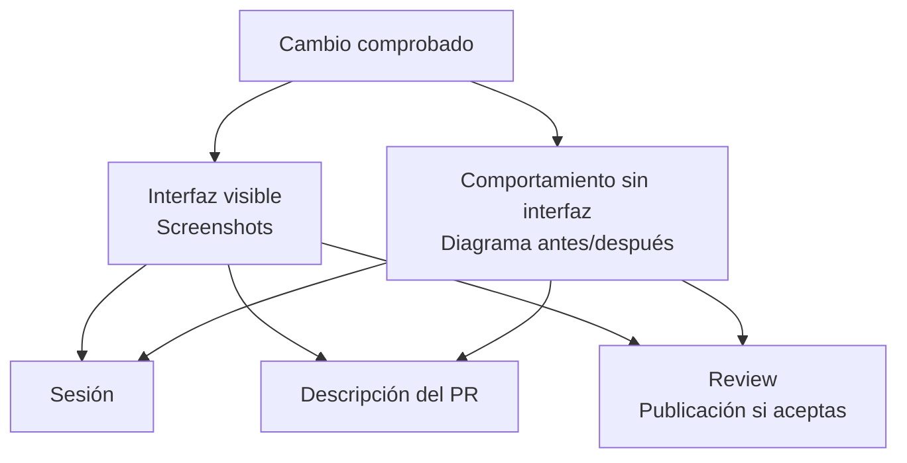
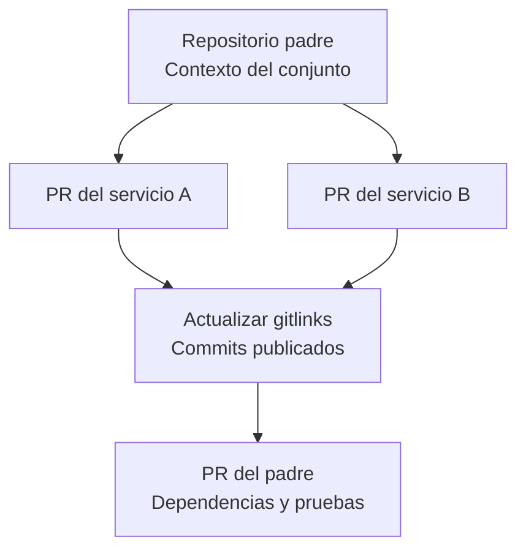
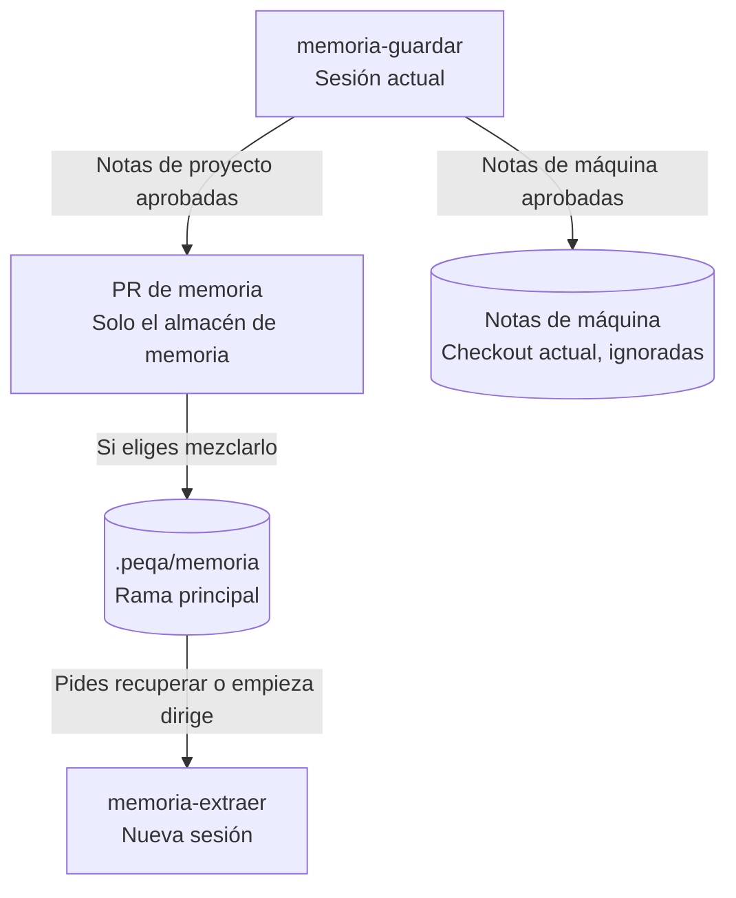
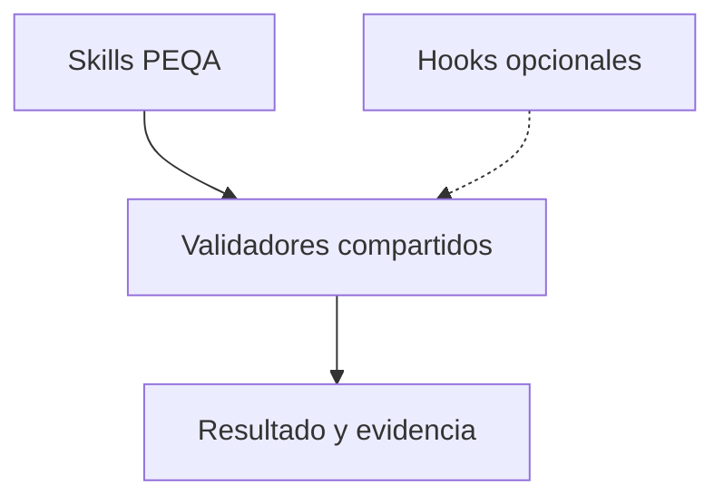
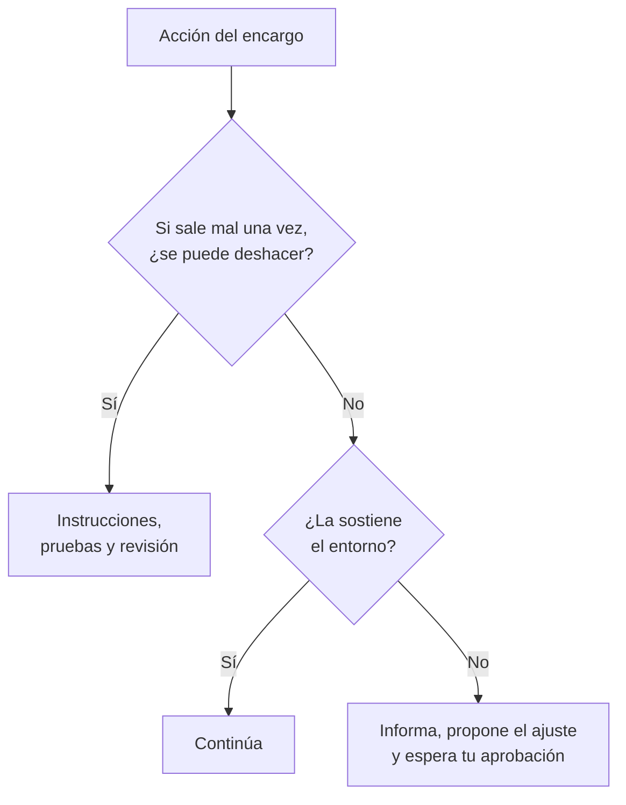

# PEQA workflows

Seis skills para decidir, implementar con agentes, diseñar interfaces, revisar y conservar contexto entre sesiones. Funcionan en **Codex y Claude Code**, también dentro de **T3 Code** y de **Orca**, con integración propia en ambos. Se adaptan al proyecto donde los uses.

`0.21.0` · Borrador público para revisión manual · [Licencia MIT](LICENSE)

## Para quién es

PEQA workflows está pensado para equipos. Busca que el trabajo salga igual de bien cada vez, lo haga quien lo haga:

- Cada cambio termina en un PR y la persona decide si se mezcla.
- Cada PR pasa por una revisión independiente, con un máximo de tres pasadas.
- Las decisiones y convenciones del proyecto se guardan como memorias, y la siguiente sesión las recupera antes de empezar.

No busca ser lo más rápido ni gastar menos. Quien trabaja solo puede ir más ligero con otros skills. Aquí se gana consistencia, y eso se nota cuando varias personas y agentes comparten un repositorio.

Se usa diciéndole a `dirige` lo que quieres y dejándolo trabajar. `dirige` reparte el trabajo entre subagentes con las herramientas del entorno en el que estés: las de T3 Code en T3 Code, las de Orca en Orca y las nativas en Codex o Claude Code. Cada entorno lo resuelve a su manera, pero el flujo es el mismo en los cuatro.

## Cómo se reparte el trabajo

`dirige` mantiene al agente padre a cargo de la entrega. Al empezar recupera la memoria del proyecto con `memoria-extraer`, si existe. Antes de editar, descubre sesiones relacionadas y acuerda quién toca los recursos compartidos. Todo cambio termina en un PR contra la rama principal, como borrador mientras el trabajo sigue. Ningún commit se queda solo en local ni va directo a la rama principal. Al terminar te pregunta si quieres mezclarlo: la decisión es tuya.



Las consultas punteadas se usan cuando aportan al trabajo. También puedes invocar cada skill por separado.

- Al empezar, `dirige` lee el catálogo de [memoria](#memoria-entre-sesiones) y extrae las notas pertinentes para el encargo. Las contrasta con el estado actual antes de decidir con ellas y pasa a cada subagente las que le sirven, con su procedencia y como contexto, no como órdenes. Sin memoria continúa sin crearla, y el informe final dice qué notas influyeron.
- `idea` cubre producto e implementación, recomienda respuestas y limita la conversación a **3 rondas por iniciativa**.
- Cuando el cambio construye o rediseña interfaz, `dirige` te pregunta si quieres el flujo completo de `ui-design` o un cambio rápido, salvo que ya lo hayas dicho. Con el completo, el padre fija la dirección visual y el inventario del sistema de diseño antes de repartir, y puntúa el resultado. Con el rápido, cada hijo aplica el cambio con los tokens y componentes que ya existen y muestra una captura. En los dos, tokens, tema y componentes compartidos tienen un solo propietario. Consulta [diseño de interfaces](#diseño-de-interfaces).
- `revisa` prefiere **GPT Sol 6.1 / xhigh** y permite **3 revisiones independientes por PR como máximo**, incluidas las repetidas, las fallidas y las canceladas. El padre decide qué corregir; se descartan detalles menores y ampliaciones de alcance. Al entregar el informe de un PR te ofrece publicarlo como comentario; solo lo publica si aceptas.
- La revisión busca las pruebas disponibles y hace que el padre ejecute las pertinentes: unitarias, integración, E2E u otras. Informa resultados y cobertura pendiente, junto al **alcance del cambio**: servicios, consumidores y datos que podrían verse afectados. Que pasen las pruebas de un servicio no demuestra que funcione toda la integración. El helper `blast_radius.py` da al revisor un mapa de partida con los archivos cambiados, quién los menciona fuera del diff y las definiciones eliminadas que siguen en uso; clasificar el impacto sigue siendo su juicio y el del padre. Consulta [pruebas e impacto](skills/revisa/references/validation.md).
- El [informe consolidado](skills/revisa/references/report.md) abre con **aprobación sugerida, cambios requeridos o revisión incompleta** y evalúa mínimos de requisitos, pruebas, seguridad y compatibilidad. Adapta el idioma e identifica la generación por IA y al solicitante cuando se conoce.
- La [revisión de seguridad](skills/revisa/references/security.md) contrasta versiones oficiales de OWASP Top 10 y NIST SSDF, comprueba controles pertinentes al cambio y declara los pendientes. No equivale a una certificación ni publica aprobaciones en GitHub.
- Los workflows y swarms se usan cuando tú los eliges. La ejecución normal utiliza subagentes.

En T3 se usan las capacidades de **Orchestrator V2** según las reglas del entorno. Desde `0.18.0`, en **Orca** se usan sus workers supervisados con el mismo criterio: subagente nativo si el hijo usa el mismo proveedor y termina en el turno, y worker de Orca para otro proveedor, segundo plano o un worktree aparte. Dentro de Orca, `revisa` lanza al revisor Sol como worker. Fuera de T3 y de Orca se usan las herramientas nativas de Codex o Claude Code. Si el revisor preferido no está disponible, se declara la alternativa utilizada. Consulta [coordinación entre sesiones](skills/dirige/references/coordination.md), [herramientas del entorno](references/runtime-tools.md) y [presupuesto de revisión](skills/revisa/references/budget.md).

## Qué le puedes pedir

| Skill | Ejemplo |
| --- | --- |
| [dirige](skills/dirige/SKILL.md) | "Implementa este cambio y coordina a los agentes". |
| [idea](skills/idea/SKILL.md) | "Cuestiona esta idea, también desde la implementación". |
| [ui-design](skills/ui-design/SKILL.md) | "Diseña la página de precios con los componentes que ya tenemos". |
| [revisa](skills/revisa/SKILL.md) | "Busca fallos materiales antes de cerrar este PR". |
| [memoria-guardar](skills/memoria-guardar/SKILL.md) | "Guarda cómo desplegamos este servicio". |
| [memoria-extraer](skills/memoria-extraer/SKILL.md) | "Recupera lo que sabemos de DevOps en este proyecto". |

## Diseño de interfaces

Desde `0.13.0`, `ui-design` construye o rediseña interfaces desde el sistema de diseño del proyecto. Antes de diseñar busca tokens, tema y componentes, y los reutiliza: una pantalla nueva no recrea botones ni estilos. La identidad visual vive en los valores de los tokens y en un único elemento distintivo. En `0.14.0` cubre también pantallas nativas en SwiftUI y Jetpack Compose, y comprueba el diff con un helper. Desde `0.15.0`, un subagente de Claude Opus y uno de Codex puntúan sobre 10 cada cambio visual del flujo completo.

### Flujo completo o cambio rápido

Desde `0.19.0`, `ui-design` te deja elegir antes de empezar. El flujo completo planifica, critica y pide la puntuación de dos revisores, y puede tardar bastante. El cambio rápido usa el sistema que ya existe, cumple el mínimo de calidad, ejecuta el helper y te muestra una captura.



- Te pregunta tanto `dirige` como `ui-design` cuando se activa sin que lo nombres, por ejemplo al pedir «ajusta la cabecera». La pregunta recomienda una opción, pero no decide por el tamaño del pedido.
- Para no responderla, dilo en el pedido: «hazlo rápido» o «con todo el proceso de diseño». Lo que dice el pedido manda también cuando invocas el skill por su nombre.
- En una ejecución no interactiva, como `claude -p`, nadie puede responder: hace el cambio rápido y lo dice en el informe.
- `dirige` hace la pregunta junto con sus otras dudas, dentro de las tres rondas de `idea`.
- El cambio rápido no hace plan visual, prueba de intercambio, crítica con señales ni puntuación. Si falta un token o un componente, lo añade al sistema y lo nombra en el informe, que termina ofreciéndote el flujo completo.

### Flujo completo



- Cada color, tipo y recurso de composición del plan indica su fuente: el encargo, el sistema, una restricción de accesibilidad o un objeto del mundo del tema. La prueba de intercambio compara el plan con el que se haría para un competidor y sustituye lo que coincide.
- Al construir, los valores literales solo viven en los archivos de tokens y cada diferencia es una variante del componente existente. El helper `ui_checks.py` lo comprueba sobre las líneas añadidas respecto a la base, lista los contratos retirados y mide el contraste. Si no puede ejecutarse, el informe deja esa comprobación pendiente. Consulta [las comprobaciones](skills/ui-design/references/design-system.md#comprobaciones).
- Un rediseño conserva lo que otros usan sin verlo: `id` y anclas, nombres de campos, atributos de prueba y analítica, rutas, deep links y metadatos.
- Las pantallas existentes conservan su aspecto. Los cambios del sistema que se notarían en ellas llegan como propuesta en el informe, salvo los que corrigen contraste, foco u otro mínimo de calidad.
- En una app nativa, los componentes de la plataforma son la base y el tema del proyecto les da su identidad. La crítica mide áreas táctiles de 44 pt en iOS y 48 dp en Android, el texto al tamaño máximo del sistema y el modo oscuro. Consulta [pantallas nativas](skills/ui-design/references/native.md).
- Una app en webview, como Tauri, Electron o Capacitor, sigue la ruta web con el tamaño mínimo y el típico de su ventana.
- La lista de señales de interfaz generada se usa después de construir, como auditoría. Si el encargo pide uno de esos estilos, se sigue el encargo.
- Las capturas de la crítica usan las herramientas de la [evidencia visual](#evidencia-visual).
- Después de la crítica, un subagente de Claude Opus y uno de Codex puntúan las capturas de 0 a 10 en nueve criterios, sin ver la autocrítica ni la nota del otro. El resultado es la media de los dos: más de 8 es bueno y más de 9, prácticamente perfecto. Si falta uno, puntúa el otro y el informe dice por qué. La escala es exigente: un criterio con algún hallazgo tiene como mucho 8, y el 10 queda para lo excepcional. Con una media de 8 o menos, o cualquier nota por debajo de 8, se corrige y se puntúa de nuevo, hasta tres rondas. Esta nota no consume el presupuesto de `revisa`. En `dirige`, el padre puntúa el cambio integrado. Consulta [puntuación](skills/ui-design/references/scoring.md).

Si tienes activo otro skill de diseño de interfaces, como `frontend-design`, desactívalo o invoca este por su nombre. Varios skills con la misma descripción compiten, y cada sesión puede cargar uno distinto.

[Pasos y referencias](skills/ui-design/SKILL.md) · [Escenarios probados](tests/ui-design-scenarios.md).

## Evidencia visual

Desde `0.11.0`, `dirige` y `revisa` acompañan cada cambio con evidencia visual: capturas de pantalla si cambia la interfaz y un diagrama antes/después si cambia el comportamiento sin interfaz. Se muestra en la sesión, va en la descripción del PR y acompaña los hallazgos de la revisión.



- Las capturas se toman con las herramientas disponibles, como Playwright, las pruebas E2E del proyecto o un simulador, usando datos de prueba. En T3 Code se ven dentro de la conversación; en la terminal recibes la ruta del archivo.
- Las imágenes se suben al PR con `gh pr create`, `gh pr edit` o `gh pr comment` y la opción `--attach`, disponible desde `gh` 2.99.0. Con una versión anterior quedan en local y el agente lo indica. Una imagen subida no puede borrarse, así que se revisa antes de subirla.
- Los diagramas usan Mermaid, que GitHub dibuja en PRs y comentarios.
- La revisión publicada es un comentario con una recomendación de IA. Aprobar o pedir cambios en GitHub sigue siendo una decisión tuya.
- Documentación, formato, renombres o versiones de dependencias se explican con texto.

[Formato, fuentes y límites](references/visual-evidence.md).

## Limpieza al terminar

Desde `0.10.0`, `dirige` registra los recursos que crea y limpia automáticamente los que ya no necesita al cerrar. Incluye worktrees auxiliares, entornos y temporales propios cuya retirada sea comprobablemente segura. Conserva cambios pendientes, archivos ignorados sin clasificar, commits, evidencia y recursos en uso; el checkout actual permanece disponible. Una espera de CI o una entrega bloqueada conserva lo necesario para continuar.

Para mantener los recursos de una ejecución, pide **«dirige este cambio y conserva los recursos al terminar»**. También puedes pedir `conservar` durante el trabajo, antes de su eliminación. No es una opción de línea de comandos ni activa hooks. La política se ejecuta mediante las instrucciones del skill y las herramientas disponibles; no instala un proceso automático ni garantiza limpieza tras un cierre abrupto del cliente.

El informe final indica qué retiró, qué conservó y por qué, con un registro recuperable fuera de las carpetas eliminadas. La limpieza de worktrees antiguos o cachés compartidas del equipo es un encargo separado. [Política y comprobaciones completas](skills/dirige/references/cleanup.md).

## Varios servicios con Git submodules

**Abre el proyecto en el repositorio padre.** Así el agente puede reconocer los servicios, sus contratos y las dependencias del conjunto, manteniendo los cambios y pruebas en cada repositorio correspondiente.



Solo los hijos modificados necesitan PR. Con submódulos anidados se sigue el orden desde los más profundos hacia arriba. El padre puede quedar como borrador mientras se integran los hijos; si un squash o rebase cambia sus SHAs, se actualizan los punteros y se comprueba la combinación final antes de fusionar el padre. [Workflow completo](references/submodules.md).

Cuando pidas guardar memoria de esta arquitectura, se conserva en el padre el contexto transversal: servicios, rutas relativas, responsabilidades y contratos, con sus fuentes. Las notas propias de un hijo conservan su procedencia. Puedes seguir trabajando únicamente en un hijo si ese es tu alcance.

## Memoria entre sesiones

Guardas conceptos concretos cuando lo pides. Desde `0.12.0`, `memoria-guardar` abre en ese momento un PR con las notas de proyecto nuevas o modificadas. Una sesión posterior puede recuperar todo o filtrar por tema. Desde `0.16.0`, `dirige` recupera al empezar las notas pertinentes para su encargo. Desde `0.17.0`, `memoria-guardar` te pregunta por cada nota antes de escribirla (guardar, editar o descartar) y, con el PR abierto, si quieres mezclarlo ahora. En T3 ambas preguntas aparecen en la propia interfaz de T3.



Cada repositorio conserva su memoria en `.peqa/memoria`. Antes de escribir, cada nota se te muestra con su alcance y contenido, y nada se guarda sin tu aprobación. Las notas de proyecto llegan a la rama principal mediante su PR; mientras no se mezcle, el PR muestra qué se va a recordar. Las de máquina, como una identidad local de GitHub, quedan en tu checkout y Git las ignora. Si el repositorio no tiene remoto en GitHub o falta `gh`, la nota se guarda en local y el agente lo indica. Se reutiliza `.peqa-stack/memoria` si ya es el único almacén existente.

Se guardan conceptos pequeños con fuente, fecha y verificación. Recuperar una nota no ejecuta sus comandos ni demuestra que siga vigente. Consulta el [formato y los límites](references/project-memory.md).

## Validación y hooks opcionales

La revisión comprueba un registro estructurado y detecta evidencia obsoleta si cambian HEAD, archivos, índice o submódulos. Una admisión atómica impide reutilizar la misma reserva de revisión entre sesiones. Los scripts funcionan por sí solos; los hooks agregan avisos o comprobaciones en el cliente.



**Codex prioriza ejecución directa**; su adaptador de hooks es experimental y solo avisa. Claude puede activar comprobaciones de despacho y una única continuación de cierre. Instalar el plugin no configura hooks ni habilita registros. Consulta [configuración, límites y comandos](references/checks-and-hooks.md).

El [registro de uso](references/usage.md) se activa por repositorio y cuenta invocaciones observadas por skill y entorno de ejecución. No guarda conversaciones, código, cuentas ni rutas, y no reconstruye el uso anterior a su activación.

## Trabajar sin aprobar cada paso

Desde `0.20.0`, `dirige` separa lo que puede dejar a las instrucciones de lo que necesita una garantía. Un skill pide una conducta; no puede garantizarla. Si pides un merge, un despliegue o una publicación, o si el checkout guarda secretos, comprueba al empezar, en modo lectura, qué sostiene el entorno. El informe final trae el ajuste que falte, sin aplicarlo. Desde `0.21.0` esa comprobación la hace un script, `environment_guarantees.py`, que lista los archivos `.env*` por nombre sin abrirlos y devuelve solo el ajuste que falta. Antes de preguntarte por un merge comprueba la protección de la rama y los checks del PR.



- **En el servidor:** protección de la rama principal y checks requeridos sobre un CI que corre en cada PR. Valen para cualquier cliente.
- **En el cliente:** reglas que niegan o piden confirmación, y el sandbox de los comandos. En Claude Code van en `.claude/settings.json`; en Codex, en las opciones de sandbox y aprobación.
- **En la entrega:** cada criterio de aceptación se liga a una comprobación que pasa o falla, y cada hijo devuelve el comando y su salida. Si ningún check corre en el PR, el informe lo dice.

Ejemplo: «dirige esta migración y mézclala cuando pasen los checks». Si `main` no exige checks, `dirige` te lo dice antes de mezclar y deja la protección propuesta en el informe final; no añade una pregunta, porque pedir el merge ya lo autoriza. Consulta [qué comprueba y qué propone en cada cliente](references/environment-guarantees.md).

## Instalar

Instala el plugin completo: sus skills comparten referencias y scripts. Una instalación sirve para distintos proyectos.

**Claude Code**

```sh
claude plugin marketplace add peqa-ai/peqa-workflows
claude plugin install peqa-workflows@peqa --scope user
```

**Codex CLI con soporte para plugins**

```sh
codex plugin marketplace add peqa-ai/peqa-workflows
codex plugin add peqa-workflows@peqa
```

Inicia una nueva sesión y selecciona el skill:

- Codex: `$peqa-workflows:dirige`.
- Claude Code: `/peqa-workflows:dirige`.

Desde la versión 0.9.0, los skills se llaman `dirige`, `idea`, `revisa`, `memoria-recuerda` y `memoria-extraer`. El espacio de nombres `peqa-workflows` ya identifica el plugin, por lo que sus nombres dejaron de repetir `peqa-`. Actualiza las invocaciones anteriores; no se instalan alias de los nombres antiguos.

En `0.16.0`, `memoria-recuerda` pasa a llamarse `memoria-guardar`, para que el nombre diga qué hace frente a `memoria-extraer`. Invócalo como `/peqa-workflows:memoria-guardar` en Claude Code o `$peqa-workflows:memoria-guardar` en Codex; el nombre anterior deja de existir y no hay alias. Pedir «guarda…» o «recuerda que…» lo activa; «¿recuerdas…?» o «¿qué sabemos de…?» activan `memoria-extraer`. Las notas guardadas no cambian de ruta, y el registro de uso agrupa los eventos antiguos bajo el nombre nuevo. Si Codex y Claude Code trabajan en el mismo repositorio, actualiza los dos: una versión anterior no lee el registro de uso con el nombre nuevo.

Las versiones `0.5.x` a `0.8.x` usaban nombres como `peqa-dirige`; en `0.9.0` pasa a `dirige`. Las memorias y los contadores de revisión conservan sus rutas y datos. El registro opcional de uso sigue leyendo los nombres históricos y agrupa sus eventos bajo los nombres actuales. `ui-design`, añadido en `0.13.0`, no tiene nombre anterior.

<details>
<summary>Probar una copia local sin instalarla globalmente</summary>

```sh
claude --plugin-dir /ruta/al/peqa-workflows
```

También puedes sustituir `peqa-ai/peqa-workflows` por una ruta local en `marketplace add`.

</details>

## Requisitos y validación

- Cliente con acceso al proyecto y herramientas de preguntas y subagentes cuando correspondan.
- Python 3.10+ para los scripts. La memoria requiere shell local y **macOS/Linux**; Windows queda pendiente.
- Los validadores, hooks y registro de uso también requieren **macOS/Linux**. La carga real de hooks en cada cliente debe comprobarse antes de depender de ella; la ruta directa permanece disponible.
- El plugin no incluye modelos ni credenciales, ni depende de TStack.
- Pendiente: validación integral de instalación y coordinación entre sesiones reales.

Desde la raíz del plugin:

```sh
python3 -m unittest discover -s tests -v
```

Las pruebas usan repositorios temporales y datos sintéticos. También comprueban el paquete: que los tres manifiestos coincidan, que cada skill se llame como su carpeta y que los enlaces relativos de la documentación existan. [El CI](.github/workflows/ci.yml) ejecuta la misma suite en cada PR, en Linux y macOS.

## Licencia

[MIT](LICENSE). Puedes usar, modificar y distribuir el plugin, también con fines comerciales y en productos cerrados, conservando el aviso de copyright y la licencia. Se proporciona sin garantía.
## Contribuir

Antes de añadir o modificar un skill, lee las [convenciones del proyecto](AGENTS.md). `CLAUDE.md` importa ese mismo archivo.

## Fuentes

La entrevista toma como referencia conceptual a [Matt Pocock](https://github.com/mattpocock/skills). Las instrucciones son propias. `ui-design` parte de una revisión del skill [`frontend-design`](https://github.com/anthropics/claude-plugins-public/tree/main/plugins/frontend-design) de Anthropic y de otros skills de diseño, y de las pruebas registradas en [sus escenarios](tests/ui-design-scenarios.md). Sus medidas de contraste y de pantallas nativas citan WCAG, Apple y Android en [crítica](skills/ui-design/references/critique.md) y [pantallas nativas](skills/ui-design/references/native.md#fuentes). El empaquetado sigue las referencias de [OpenAI](https://developers.openai.com/plugins/build/plugins) y [Claude Code](https://code.claude.com/docs/en/plugins-reference); los contratos de T3 se citan en [herramientas del entorno](references/runtime-tools.md).
