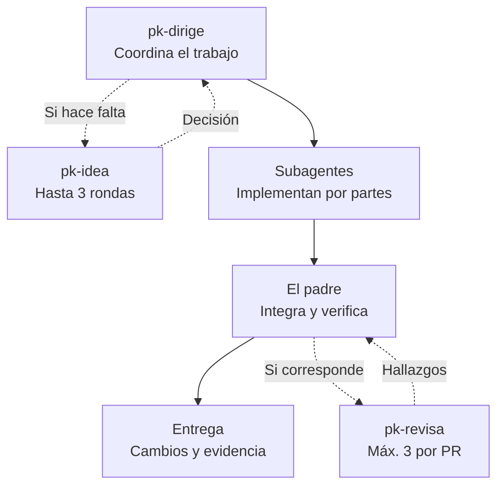
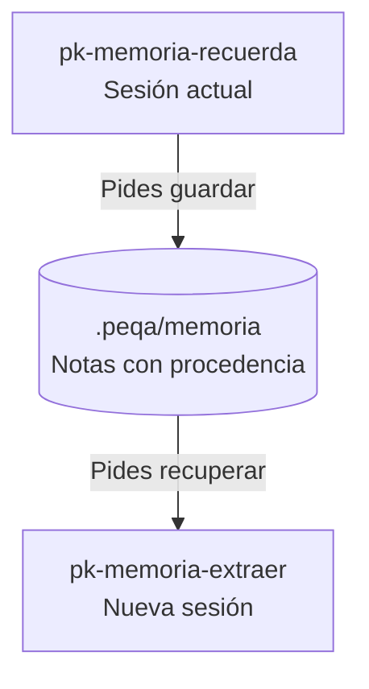

# PEQA workflows

Cinco skills para decidir, implementar con agentes, revisar y conservar contexto entre sesiones. Funcionan en **Codex y Claude Code**, con integración preferente en **T3 Code**. Se adaptan al proyecto donde los uses.

`0.4.0` · Borrador público para revisión manual · [Licencia MIT](LICENSE)

## Cómo se reparte el trabajo

`pk-dirige` mantiene al agente padre a cargo de la entrega. Antes de editar, descubre sesiones relacionadas y acuerda quién toca los recursos compartidos.



Las consultas punteadas se usan cuando aportan al trabajo. También puedes invocar cada skill por separado.

- `pk-idea` cubre producto e implementación, recomienda respuestas y limita la conversación a **3 rondas por iniciativa**.
- `pk-revisa` prefiere **GPT Sol 6.1 / xhigh** y permite **3 revisiones independientes por PR como máximo**, incluidos rechecks, fallos y cancelaciones. El padre decide qué corregir; se descartan nitpicks y ampliaciones de alcance. No publica comentarios en GitHub.
- Los workflows y swarms se usan cuando tú los eliges. La ejecución normal utiliza subagentes.

En T3 se usan las capacidades de **Orchestrator V2** según las reglas del entorno. Fuera de T3 se usan las herramientas nativas de Codex o Claude Code. Si el revisor preferido no está disponible, se declara la alternativa utilizada. Consulta [coordinación entre sesiones](skills/pk-dirige/references/coordination.md), [herramientas del entorno](references/runtime-tools.md) y [presupuesto de revisión](skills/pk-revisa/references/budget.md).

## Qué le puedes pedir

| Skill | Ejemplo |
| --- | --- |
| [pk-dirige](skills/pk-dirige/SKILL.md) | "Implementa este cambio y coordina a los agentes". |
| [pk-idea](skills/pk-idea/SKILL.md) | "Cuestiona esta idea, también desde la implementación". |
| [pk-revisa](skills/pk-revisa/SKILL.md) | "Busca fallos materiales antes de cerrar este PR". |
| [pk-memoria-recuerda](skills/pk-memoria-recuerda/SKILL.md) | "Recuerda cómo desplegamos este servicio". |
| [pk-memoria-extraer](skills/pk-memoria-extraer/SKILL.md) | "Recupera lo que sabemos de DevOps en este proyecto". |

## Memoria entre sesiones

Guardas conceptos concretos cuando lo pides. Una sesión posterior puede recuperar todo o filtrar por tema.



Cada repositorio conserva su memoria en `.peqa/memoria`. Las notas de proyecto pueden compartirse por Git; las de máquina, como una identidad local de GitHub, se ignoran. Se reutiliza `.peqa-stack/memoria` si ya es el único almacén existente.

Se guardan conceptos pequeños con fuente, fecha y verificación. Recuperar una nota no ejecuta sus comandos ni demuestra que siga vigente. Consulta el [formato y los límites](references/project-memory.md).

## Instalar

Instala el plugin completo: sus skills comparten referencias y scripts. Una instalación sirve para distintos proyectos.

**Claude Code**

```sh
claude plugin marketplace add peqa-ai/peqa-workflows
claude plugin install peqa-workflows@peqa --scope user
```

**Codex CLI con soporte para plugins**

```sh
codex plugin marketplace add peqa-ai/peqa-workflows
codex plugin add peqa-workflows@peqa
```

Inicia una nueva sesión y selecciona el skill. En Claude Code, por ejemplo: `/peqa-workflows:pk-dirige`.

Desde `0.4.0`, todos los skills usan el prefijo `pk-`. Si vienes de `0.3.x`, actualiza tus invocaciones a los nombres de la tabla. Las memorias y los contadores de revisión conservan sus rutas y datos.

<details>
<summary>Probar una copia local sin instalarla globalmente</summary>

```sh
claude --plugin-dir /ruta/al/peqa-workflows
```

También puedes sustituir `peqa-ai/peqa-workflows` por una ruta local en `marketplace add`.

</details>

## Requisitos y validación

- Cliente con acceso al proyecto y herramientas de preguntas y subagentes cuando correspondan.
- Python 3.10+ para los scripts. La memoria requiere shell local y **macOS/Linux**; Windows queda pendiente.
- El plugin no incluye modelos ni credenciales, ni depende de TStack.
- Pendiente: validación integral de instalación y coordinación entre sesiones reales.

Desde la raíz del plugin:

```sh
python3 -m unittest discover -s tests -v
```

Las pruebas usan repositorios temporales y datos sintéticos.

## Licencia

[MIT](LICENSE). Puedes usar, modificar y distribuir el plugin, también con fines comerciales y en productos cerrados, conservando el aviso de copyright y la licencia. Se proporciona sin garantía.

## Contribuir

Antes de añadir o modificar un skill, lee las [convenciones del proyecto](AGENTS.md). `CLAUDE.md` importa ese mismo archivo.

## Fuentes

La entrevista toma como referencia conceptual a [Matt Pocock](https://github.com/mattpocock/skills). Las instrucciones son propias. El empaquetado sigue las referencias de [OpenAI](https://developers.openai.com/plugins/build/plugins) y [Claude Code](https://code.claude.com/docs/en/plugins-reference); los contratos de T3 se citan en [herramientas del entorno](references/runtime-tools.md).
