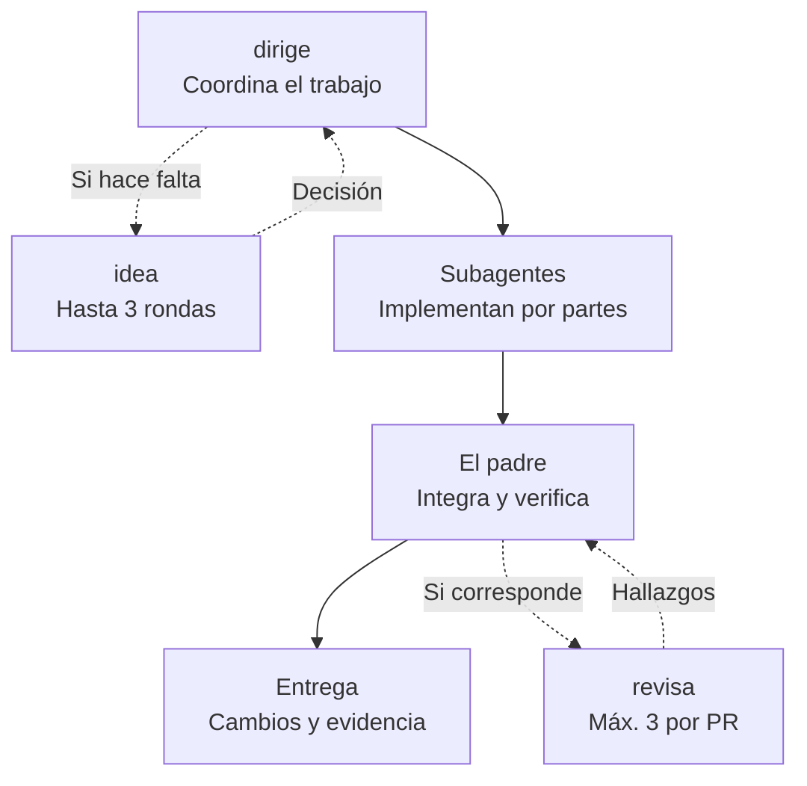
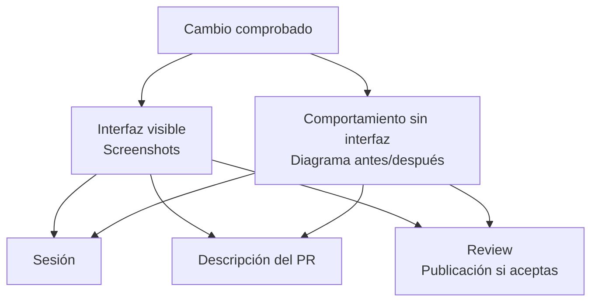
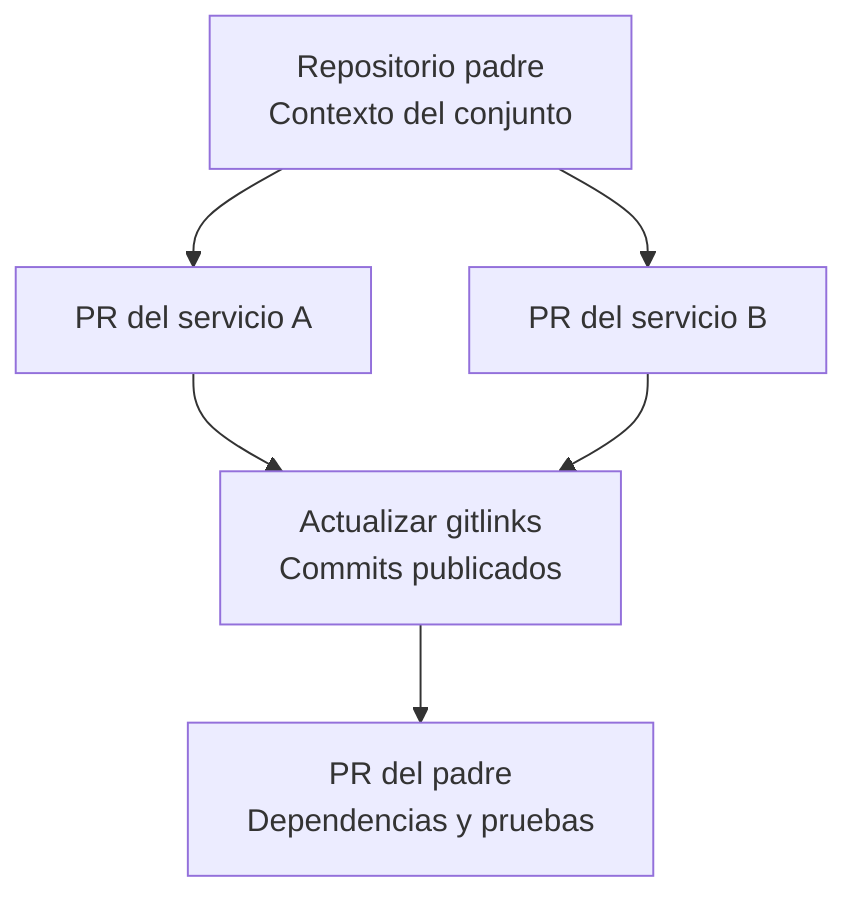
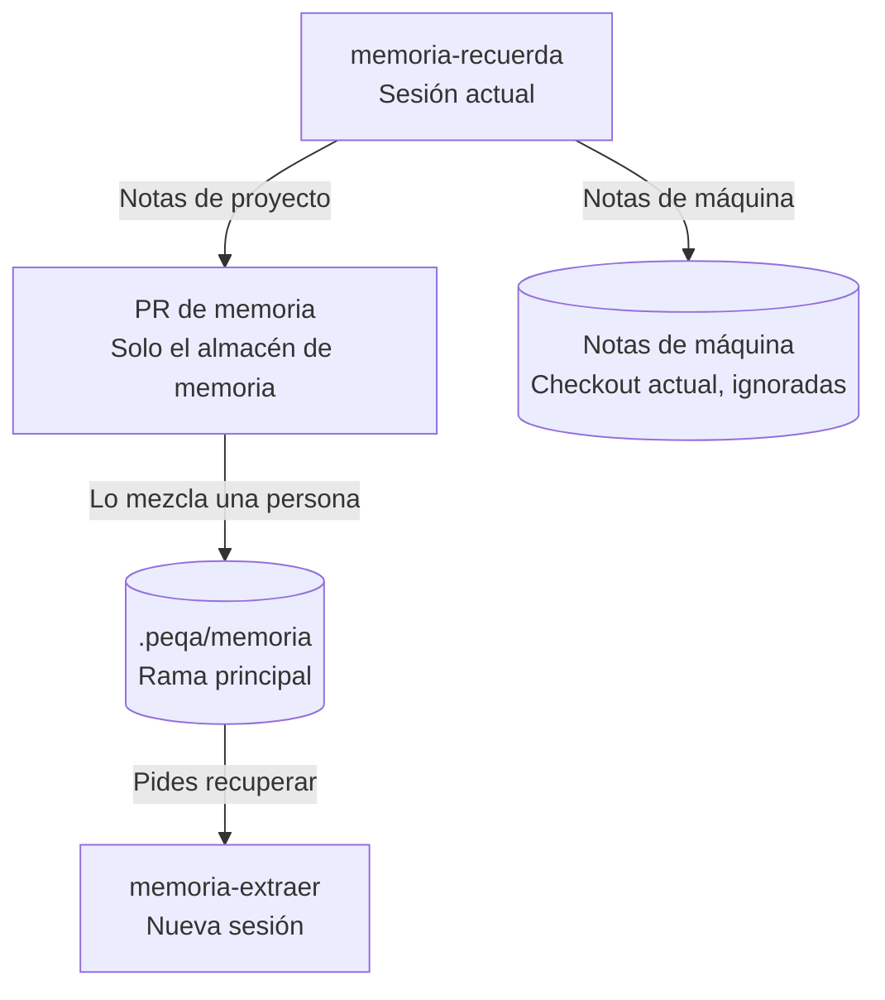
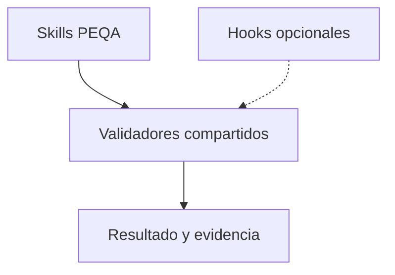

# PEQA workflows

Cinco skills para decidir, implementar con agentes, revisar y conservar contexto entre sesiones. Funcionan en **Codex y Claude Code**, con integración preferente en **T3 Code**. Se adaptan al proyecto donde los uses.

`0.12.0` · Borrador público para revisión manual · [Licencia MIT](LICENSE)

## Cómo se reparte el trabajo

`dirige` mantiene al agente padre a cargo de la entrega. Antes de editar, descubre sesiones relacionadas y acuerda quién toca los recursos compartidos.



Las consultas punteadas se usan cuando aportan al trabajo. También puedes invocar cada skill por separado.

- `idea` cubre producto e implementación, recomienda respuestas y limita la conversación a **3 rondas por iniciativa**.
- `revisa` prefiere **GPT Sol 6.1 / xhigh** y permite **3 revisiones independientes por PR como máximo**, incluidos rechecks, fallos y cancelaciones. El padre decide qué corregir; se descartan nitpicks y ampliaciones de alcance. Al entregar el informe de un PR te ofrece publicarlo como comentario; solo lo publica si aceptas.
- El review busca las pruebas disponibles y hace que el padre ejecute las pertinentes: unitarias, integración, E2E u otras. Informa resultados y cobertura pendiente, junto al **blast radius**: servicios, consumidores y datos que podrían verse afectados. Tests verdes en un servicio no prueban toda la integración. Consulta [pruebas e impacto](skills/revisa/references/validation.md).
- El [informe consolidado](skills/revisa/references/report.md) abre con **aprobación sugerida, cambios requeridos o revisión incompleta** y evalúa mínimos de requisitos, pruebas, seguridad y compatibilidad. Adapta el idioma e identifica la generación por IA y al solicitante cuando se conoce.
- La [revisión de seguridad](skills/revisa/references/security.md) contrasta versiones oficiales de OWASP Top 10 y NIST SSDF, comprueba controles pertinentes al cambio y declara los pendientes. No equivale a una certificación ni publica aprobaciones en GitHub.
- Los workflows y swarms se usan cuando tú los eliges. La ejecución normal utiliza subagentes.

En T3 se usan las capacidades de **Orchestrator V2** según las reglas del entorno. Fuera de T3 se usan las herramientas nativas de Codex o Claude Code. Si el revisor preferido no está disponible, se declara la alternativa utilizada. Consulta [coordinación entre sesiones](skills/dirige/references/coordination.md), [herramientas del entorno](references/runtime-tools.md) y [presupuesto de revisión](skills/revisa/references/budget.md).

## Qué le puedes pedir

| Skill | Ejemplo |
| --- | --- |
| [dirige](skills/dirige/SKILL.md) | "Implementa este cambio y coordina a los agentes". |
| [idea](skills/idea/SKILL.md) | "Cuestiona esta idea, también desde la implementación". |
| [revisa](skills/revisa/SKILL.md) | "Busca fallos materiales antes de cerrar este PR". |
| [memoria-recuerda](skills/memoria-recuerda/SKILL.md) | "Recuerda cómo desplegamos este servicio". |
| [memoria-extraer](skills/memoria-extraer/SKILL.md) | "Recupera lo que sabemos de DevOps en este proyecto". |

## Evidencia visual

Desde `0.11.0`, `dirige` y `revisa` acompañan cada cambio con evidencia visual: screenshots si cambia la interfaz y un diagrama antes/después si cambia el comportamiento sin interfaz. Se muestra en la sesión, va en la descripción del PR y acompaña los hallazgos del review.



- Los screenshots se toman con las herramientas disponibles, como Playwright, las pruebas E2E del proyecto o un simulador, usando datos de prueba. En T3 Code se ven dentro de la conversación; en la terminal recibes la ruta del archivo.
- Las imágenes se suben al PR con `gh pr create`, `gh pr edit` o `gh pr comment` y la opción `--attach`, disponible desde `gh` 2.99.0. Con una versión anterior quedan en local y el agente lo indica. Una imagen subida no puede borrarse, así que se revisa antes de subirla.
- Los diagramas usan Mermaid, que GitHub dibuja en PRs y comentarios.
- El review publicado es un comentario con una recomendación de IA. Aprobar o pedir cambios en GitHub sigue siendo una decisión tuya.
- Documentación, formato, renombres o versiones de dependencias se explican con texto.

[Formato, fuentes y límites](references/visual-evidence.md).

## Limpieza al terminar

Desde `0.10.0`, `dirige` registra los recursos que crea y limpia automáticamente los que ya no necesita al cerrar. Incluye worktrees auxiliares, entornos y temporales propios cuya retirada sea comprobablemente segura. Conserva cambios pendientes, archivos ignorados sin clasificar, commits, evidencia y recursos en uso; el checkout actual permanece disponible. Una espera de CI o una entrega bloqueada conserva lo necesario para continuar.

Para mantener los recursos de una ejecución, pide **«dirige este cambio y conserva los recursos al terminar»**. También puedes pedir `conservar` durante el trabajo, antes de su eliminación. No es un flag de línea de comandos ni activa hooks. La política se ejecuta mediante las instrucciones del skill y las herramientas disponibles; no instala un proceso automático ni garantiza limpieza tras un cierre abrupto del cliente.

El informe final indica qué retiró, qué conservó y por qué, con un registro recuperable fuera de las carpetas eliminadas. La limpieza de worktrees antiguos o cachés compartidas del equipo es un encargo separado. [Política y comprobaciones completas](skills/dirige/references/cleanup.md).

## Varios servicios con Git submodules

**Abre el proyecto en el repositorio padre.** Así el agente puede reconocer los servicios, sus contratos y las dependencias del conjunto, manteniendo los cambios y pruebas en cada repositorio correspondiente.



Solo los hijos modificados necesitan PR. Con submódulos anidados se sigue el orden desde los más profundos hacia arriba. El padre puede quedar en draft mientras se integran los hijos; si un squash o rebase cambia sus SHAs, se actualizan los punteros y se comprueba la combinación final antes de fusionar el padre. [Workflow completo](references/submodules.md).

Cuando pidas guardar memoria de esta arquitectura, se conserva en el padre el contexto transversal: servicios, rutas relativas, responsabilidades y contratos, con sus fuentes. Las notas propias de un hijo conservan su procedencia. Puedes seguir trabajando únicamente en un hijo si ese es tu alcance.

## Memoria entre sesiones

Guardas conceptos concretos cuando lo pides. Desde `0.12.0`, `memoria-recuerda` abre en ese momento un PR con las notas de proyecto nuevas o modificadas. Una sesión posterior puede recuperar todo o filtrar por tema.



Cada repositorio conserva su memoria en `.peqa/memoria`. Las notas de proyecto llegan a la rama principal mediante su PR; mientras no se mezcle, el PR muestra qué se va a recordar. Las de máquina, como una identidad local de GitHub, quedan en tu checkout y Git las ignora. Si el repositorio no tiene remoto en GitHub o falta `gh`, la nota se guarda en local y el agente lo indica. Se reutiliza `.peqa-stack/memoria` si ya es el único almacén existente.

Se guardan conceptos pequeños con fuente, fecha y verificación. Recuperar una nota no ejecuta sus comandos ni demuestra que siga vigente. Consulta el [formato y los límites](references/project-memory.md).

## Validación y hooks opcionales

El review comprueba un registro estructurado y detecta evidencia obsoleta si cambian HEAD, archivos, índice o submódulos. Una admisión atómica impide reutilizar la misma reserva de revisión entre sesiones. Los scripts funcionan por sí solos; los hooks agregan avisos o comprobaciones en el cliente.



**Codex prioriza ejecución directa**; su adaptador de hooks es experimental y solo avisa. Claude puede activar comprobaciones de despacho y una única continuación de cierre. Instalar el plugin no configura hooks ni habilita registros. Consulta [configuración, límites y comandos](references/checks-and-hooks.md).

El [registro de uso](references/usage.md) se activa por repositorio y cuenta invocaciones observadas por skill y runtime. No guarda conversaciones, código, cuentas ni rutas, y no reconstruye el uso anterior a su activación.

## Instalar

Instala el plugin completo: sus skills comparten referencias y scripts. Una instalación sirve para distintos proyectos.

**Claude Code**

```sh
claude plugin marketplace add peqa-ai/peqa-workflows
claude plugin install peqa-workflows@peqa --scope user
```

**Codex CLI con soporte para plugins**

```sh
codex plugin marketplace add peqa-ai/peqa-workflows
codex plugin add peqa-workflows@peqa
```

Inicia una nueva sesión y selecciona el skill:

- Codex: `$peqa-workflows:dirige`.
- Claude Code: `/peqa-workflows:dirige`.

Desde la versión 0.9.0, los skills se llaman `dirige`, `idea`, `revisa`, `memoria-recuerda` y `memoria-extraer`. El namespace `peqa-workflows` ya identifica el plugin, por lo que sus nombres dejaron de repetir `peqa-`. Actualiza las invocaciones anteriores; no se instalan aliases de los nombres antiguos.

Las versiones `0.5.x` a `0.8.x` usaban nombres como `peqa-dirige`; en `0.9.0` pasa a `dirige`. Las memorias y los contadores de revisión conservan sus rutas y datos. El registro opcional de uso sigue leyendo los nombres históricos y agrupa sus eventos bajo los nombres actuales.

<details>
<summary>Probar una copia local sin instalarla globalmente</summary>

```sh
claude --plugin-dir /ruta/al/peqa-workflows
```

También puedes sustituir `peqa-ai/peqa-workflows` por una ruta local en `marketplace add`.

</details>

## Requisitos y validación

- Cliente con acceso al proyecto y herramientas de preguntas y subagentes cuando correspondan.
- Python 3.10+ para los scripts. La memoria requiere shell local y **macOS/Linux**; Windows queda pendiente.
- Los validadores, hooks y registro de uso también requieren **macOS/Linux**. La carga real de hooks en cada cliente debe comprobarse antes de depender de ella; la ruta directa permanece disponible.
- El plugin no incluye modelos ni credenciales, ni depende de TStack.
- Pendiente: validación integral de instalación y coordinación entre sesiones reales.

Desde la raíz del plugin:

```sh
python3 -m unittest discover -s tests -v
```

Las pruebas usan repositorios temporales y datos sintéticos.

## Licencia

[MIT](LICENSE). Puedes usar, modificar y distribuir el plugin, también con fines comerciales y en productos cerrados, conservando el aviso de copyright y la licencia. Se proporciona sin garantía.

## Contribuir

Antes de añadir o modificar un skill, lee las [convenciones del proyecto](AGENTS.md). `CLAUDE.md` importa ese mismo archivo.

## Fuentes

La entrevista toma como referencia conceptual a [Matt Pocock](https://github.com/mattpocock/skills). Las instrucciones son propias. El empaquetado sigue las referencias de [OpenAI](https://developers.openai.com/plugins/build/plugins) y [Claude Code](https://code.claude.com/docs/en/plugins-reference); los contratos de T3 se citan en [herramientas del entorno](references/runtime-tools.md).
